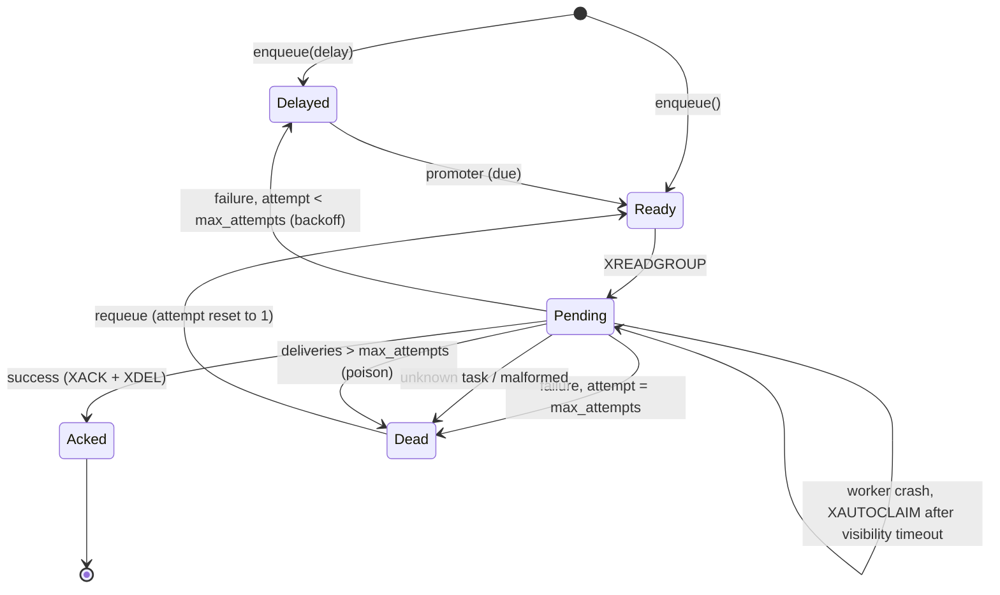

# StreamWorker

A small, reliable background-job library for Python, built on **Redis Streams** and
**asyncio**. It recovers jobs after worker crashes, retries failures with exponential
backoff, and isolates permanently failing jobs in a dead-letter stream, without the
weight of a full task-queue framework.

> **Honest scope.** StreamWorker is intentionally small and exists to show the
> reliability mechanics explicitly. For production-critical systems that need more
> features, prefer a mature tool; see [Prior art](#prior-art-and-when-to-use-it-instead).

## Why

A simple `LPUSH`/`BRPOP` list queue loses a job when a worker dies mid-task, retries
poison messages forever, and gives you no visibility. Celery solves these problems but is
heavy for a small service. StreamWorker uses consumer groups, pending-entry recovery and
a few atomic Lua scripts to cover the failure cases that matter.

> ### Delivery guarantees
>
> * **At-least-once.** A job can run more than once, for example when a worker crashes
>   after performing a side effect but before acknowledging. **Handlers must be
>   idempotent.**
> * **No ordering guarantee** when `concurrency > 1`. Retried jobs re-enter behind newer ones.
> * **Durability is Redis's durability.** Enable AOF (`appendonly yes`) if losing recently
>   enqueued jobs on a Redis crash is unacceptable.
> * **`max_len` trimming can drop the oldest entries**, including unprocessed jobs.
>   Leave it unset or size it generously.
> * Handler timeouts are cooperative: a handler that blocks the event loop cannot be
>   interrupted.

Requirements: Python 3.11+, Redis 7.2+ (CI uses `redis:7.4`). Valkey speaks the same
protocol but is untested.

## Quick start

```bash
pip install streamworker            # add [admin] for the FastAPI admin API
docker compose up -d --wait         # Redis 7.4 on 127.0.0.1:6379 (from this repo's compose.yaml)
```

Define handlers and a worker (`tasks.py`):

```python
import redis.asyncio as aioredis
from streamworker import JobContext, Queue, Worker


async def send_welcome(
    payload: dict, ctx: JobContext
) -> None: ...  # must be idempotent; ctx.job_id is a stable key for deduplication


redis = aioredis.from_url("redis://127.0.0.1:6379/0", decode_responses=True)  # required
queue = Queue(redis, "emails")
worker = Worker(queue, {"send_welcome": send_welcome}, concurrency=10)
```

Run it (handles SIGTERM/SIGINT gracefully):

```bash
streamworker run tasks:worker
```

Enqueue from anywhere:

```python
job_id = await queue.enqueue(
    "send_welcome", {"user_id": 42}, idempotency_key="welcome:42", max_attempts=5
)
```

See [`examples/`](examples) for a complete setup, and run
`python examples/crash_demo.py` to watch a `SIGKILL`ed worker's job get recovered live.

## How it works



* **Consumer groups.** Jobs live in one stream, `sw:{queue}:stream`. Workers read with
  `XREADGROUP`, which hands each entry to exactly one consumer and records it in the
  group's *pending entries list* until it is acknowledged. A worker that dies leaves its
  entries pending instead of losing them.
* **`XAUTOCLAIM` recovery.** Every worker periodically claims entries that have been
  pending longer than `visibility_timeout` and runs them. If an entry has been delivered
  more times than its `max_attempts`, it is a poison message that keeps killing workers,
  so it goes to the dead-letter stream (`MaxDeliveriesExceeded`) instead of running again.
* **The delayed set.** Retries and `delay=` jobs wait in a sorted set scored by due time.
  A promoter loop (in every worker, safe to run concurrently) moves due members into the
  stream using Redis's own clock, so client clock skew cannot matter.
* **Lua atomicity.** Each multi-key transition is one Lua script: idempotent enqueue
  (`SET NX` + `XADD`), promotion (`ZREM` + `XADD`), retry (`XACK` + `ZADD` + `XDEL`) and
  dead-lettering (`XACK` + `XADD` + `XDEL`). A crash can never leave a job in two places
  or none. Retry and dead-letter only act if the `XACK` removed the entry, so two
  consumers racing for the same entry cannot both reschedule it.
* **Graceful shutdown.** On SIGTERM/SIGINT a worker stops reading, waits up to
  `shutdown_grace` for in-flight jobs, then cancels the rest. Cancelled jobs stay pending
  and are recovered by another worker.

## Writing idempotent handlers

Because delivery is at-least-once, make the side effect safe to repeat. The simplest
robust pattern is a database unique constraint keyed on the job id:

```python
async def charge_customer(payload: dict, ctx: JobContext) -> None:
    async with db.transaction():
        inserted = await db.execute(
            "INSERT INTO charges (job_id, customer_id, cents) VALUES ($1, $2, $3) "
            "ON CONFLICT (job_id) DO NOTHING",
            ctx.job_id,
            payload["customer_id"],
            payload["cents"],
        )
        if inserted == "INSERT 0 0":
            return  # a previous delivery already did the work
        await payment_gateway.charge(
            payload["customer_id"], payload["cents"], idempotency_key=ctx.job_id
        )
```

[`examples/tasks.py`](examples/tasks.py) has a runnable SQLite version. Note that
`idempotency_key` on `enqueue` only prevents *duplicate enqueues*; it does not make
handler execution exactly-once.

## Configuration reference

`Queue(redis, name, *, max_len=None, max_payload_bytes=524288, idempotency_ttl=1 day, group="workers")`

| Argument | Meaning |
|---|---|
| `redis` | `redis.asyncio.Redis` created with `decode_responses=True` (RESP2, the default protocol). |
| `max_len` | Approximate `MAXLEN ~` trimming of the stream. See the guarantees box. |
| `max_payload_bytes` | Serialised payload limit; larger payloads raise `PayloadTooLargeError`. |
| `idempotency_ttl` | How long an `idempotency_key` suppresses duplicates. |

`queue.enqueue(task, payload=None, *, idempotency_key=None, max_attempts=5, delay=None)`
returns the job id. Payloads must be JSON-serialisable, otherwise `SerializationError`.

`Worker(queue, handlers, *, concurrency=10, visibility_timeout=60s, handler_timeout=30s, backoff=ExponentialBackoff(1.0, 300.0, "full"), shutdown_grace=30s, poll_interval=1s, promote_interval=1s, recovery_interval=None)`

| Argument | Meaning |
|---|---|
| `handlers` | Mapping of task name to `async def handler(payload)` or `handler(payload, ctx)`. |
| `concurrency` | Maximum jobs running at once in this worker. |
| `visibility_timeout` | How long a job may stay unacknowledged before another worker takes it over. Must exceed `handler_timeout`. |
| `handler_timeout` | Per-attempt limit; exceeding it counts as a failure. |
| `backoff` | Callable `attempt -> seconds`. `ExponentialBackoff(base, cap, jitter="full"\|"equal"\|"none")`. |
| `shutdown_grace` | How long shutdown waits for in-flight jobs before cancelling them. |
| `poll_interval` | `XREADGROUP` block time and how often the worker checks for a stop request. |
| `promote_interval` | How often delayed jobs are promoted. |
| `recovery_interval` | How often stalled jobs are reclaimed (default: half of `visibility_timeout`, at most 5 s). |

Keep the Redis connection pool larger than `concurrency + 4` (a warning is logged
otherwise). Failed attempts are retried while `attempt < max_attempts`; the dead-letter
entry stores the job, `error_type`, `error_message` (truncated to 1,000 characters) and
`failed_at`. The worker never closes the Redis client you gave it.

## CLI

The Redis URL comes from `--redis-url` or `REDIS_URL`. Passwords are never printed.

```bash
streamworker run tasks:worker                    # a Worker, or a callable returning one
streamworker stats --queue emails [--json]
streamworker dead list --queue emails [--limit 50] [--include-payload] [--json]
streamworker dead requeue --queue emails --id 1700000000000-0   # or --all
streamworker dead purge --queue emails --id 1700000000000-0     # or --all
```

`requeue` resets `attempt` to 1. `purge` and `requeue` require `--id` or `--all`, so a
bare command can never delete everything by accident.

## Admin API

```python
from streamworker.admin import create_admin_app

app = create_admin_app(redis, queues=["emails"], api_key=os.environ["ADMIN_API_KEY"])
# uvicorn myapp:app
```

Send the key in an `X-API-Key` header (compared in constant time). Run it behind TLS.

| Route | Purpose |
|---|---|
| `GET /queues`, `GET /queues/{name}` | queue statistics |
| `GET /queues/{name}/dead?limit&cursor&include_payload` | page through dead jobs; payloads hidden unless `include_payload=true` |
| `POST /queues/{name}/dead/{id}/requeue` | requeue with `attempt` reset to 1 |
| `DELETE /queues/{name}/dead/{id}` | delete a dead job |

## Operations

* **Persistence.** Run Redis with AOF (`appendonly yes`); `compose.yaml` does. Without it,
  a Redis restart can lose jobs.
* **Memory and trimming.** Acknowledged jobs are deleted from the stream, so it holds only
  ready and in-flight jobs. The dead-letter stream grows until you `requeue` or `purge`
  it. Treat it as sensitive: it stores payloads and exception messages.
* **Monitoring.** `streamworker stats` (or `Queue.stats()`) reports `length` (ready plus
  in-flight), `pending`, `consumers`, `delayed`, `dead` and `oldest_pending_age_ms`
  (age of the oldest unacknowledged entry, by stream-id timestamp). Alert on `dead > 0`
  and a growing `oldest_pending_age_ms`.
* **Logging.** The `streamworker` logger records job ids, task names and error types.
  It never logs payloads or exception messages.
* **Deploying.** Send SIGTERM and give the process longer than `shutdown_grace` before
  SIGKILL. Anything cut off is recovered after `visibility_timeout`.

## Limitations

No cron schedules, priorities, rate limiting, result storage, workflows, Redis Cluster
support or web dashboard. Ordering is not guaranteed. The poison-message counter is per
stream entry, so a retried job gets a fresh count. Handlers must be `async`; run blocking
code with `asyncio.to_thread`. Only RESP2 and `decode_responses=True` clients are supported.

## Prior art and when to use it instead

[Celery](https://docs.celeryq.dev), [RQ](https://python-rq.org),
[arq](https://arq-docs.helpmanual.io), [Dramatiq](https://dramatiq.io) and
[Taskiq](https://taskiq-python.github.io) are mature and feature-rich. Choose them when
you need scheduling, priorities, result backends, multiple brokers, a large ecosystem or
vendor support. StreamWorker is for small services that already run Redis and want a
readable, well-tested reliability core.

## Development

```bash
make redis-up            # Redis 7.4 via Docker Compose
make install             # editable install with dev dependencies
make check               # ruff, mypy --strict, tests with >= 90% branch coverage
make redis-down
```

Integration tests use a real Redis (`REDIS_URL`, default `redis://127.0.0.1:6379/15`;
**database 15 is flushed per test**). If Redis is unreachable they skip with a clear
message; set `STREAMWORKER_REQUIRE_REDIS=1` to make that a failure (CI does). The
failure-path tests (crash recovery with `SIGKILL`, poison messages, graceful shutdown,
idempotency races) are the heart of the project.

`python benchmarks/throughput.py` measures throughput on your own hardware. No numbers
are quoted here because they would not transfer to your environment.

## License

MIT
