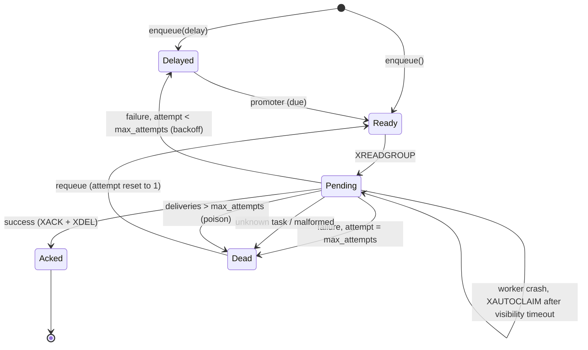

# StreamWorker specification

StreamWorker is a small asyncio job-processing library on Redis Streams. This
document is the design reference; `README.md` is the user-facing guide.

## 1. Guarantees

* **At-least-once delivery.** A job may run more than once (for example a
  worker crashes after a side effect but before acknowledging). Handlers must be
  idempotent.
* **No ordering guarantee** when concurrency is greater than one, and retries
  re-enter the queue behind newer jobs.
* **Durability** is whatever the Redis deployment provides. Use AOF
  (`appendonly yes`) if losing recently enqueued jobs on a Redis crash matters.
* **Stream trimming** (`max_len`) uses approximate `MAXLEN ~` and can drop the
  *oldest* entries, including unprocessed ones, when the stream is longer than
  the limit. Size it generously or leave it unset.
* Payloads are never logged. Job ids, task names and error types are.

Non-goals for v0.1.0: cron schedules, priorities, rate limiting, result
storage, workflows, Redis Cluster, a web dashboard.

## 2. Redis keys

All keys live under `sw:{queue}:` (the queue name is substituted literally).

| Key | Type | Purpose |
|---|---|---|
| `sw:{queue}:stream` | stream | ready and in-flight jobs |
| `sw:{queue}:delayed` | sorted set | score = due time (ms), member = JSON job |
| `sw:{queue}:dead` | stream | permanently failed jobs |
| `sw:{queue}:idem:{key}` | string | idempotency marker (value = job id, TTL) |

Consumer group: `workers` by default, created with `MKSTREAM` and start id `0`.

## 3. Job format

Stream fields (all strings): `id` (UUID4), `task`, `payload` (JSON text),
`attempt` (starts at 1), `max_attempts`, `enqueued_at` (ms since epoch),
`idempotency_key` (optional). Dead-letter entries additionally carry
`error_type`, `error_message` (at most 1,000 characters) and `failed_at` (ms).

Delayed members are the same fields serialised as one JSON object of strings.

## 4. Lua scripts (atomicity)

Every multi-key state transition is one Lua script, so a crash can never leave
a job in two places or in none.

| Script | Effect |
|---|---|
| `enqueue` | optional `SET idem NX PX`, then `XADD` (or `ZADD` to delayed using server `TIME`). A duplicate key returns the original job id. |
| `promote` | server `TIME`; `ZRANGEBYSCORE ... LIMIT`, `ZREM`, `XADD` for each due member. A `ZREM` and its `XADD` are in the same script, so concurrent promoters cannot duplicate a job. |
| `retry` | `XACK` the original; only if that returned 1, `ZADD` the next attempt to delayed at `TIME + backoff`, then `XDEL`. |
| `dead` | `XACK` the original; only if that returned 1, `XADD` to dead with error fields, then `XDEL`. |
| `requeue` | read a dead entry, `XADD` it to the stream with `attempt=1`, `XDEL` it from dead. |

Gating on the `XACK` result makes retry/dead idempotent when two consumers race
for the same entry (for example after a slow handler was reclaimed).

## 5. State machine

## 6. Worker behaviour

* Consumer name `{hostname}-{pid}-{random4}`.
* Reader loop: `XREADGROUP ... COUNT n BLOCK ms`, where `n` is the number of free
  slots (a semaphore of size `concurrency`). Each job runs in its own task under
  `asyncio.timeout(handler_timeout)`.
* Success: `XACK` + `XDEL` in one `MULTI` pipeline.
* Handler exception or timeout: `retry` script if `attempt < max_attempts`,
  otherwise `dead`. Unknown task: `dead` immediately with `UnknownTask`.
* Promoter loop: runs the `promote` script every `promote_interval`.
* Recovery loop: `XAUTOCLAIM` with `min-idle-time = visibility_timeout`. For each
  claimed entry, `XPENDING` gives the delivery count; if it exceeds the job's
  `max_attempts` the job is dead-lettered as `MaxDeliveriesExceeded` without
  running. Ids reported as deleted are logged and counted.
* Graceful shutdown (SIGTERM/SIGINT or `Worker.stop()`): stop reading, wait for
  in-flight jobs up to `shutdown_grace`, cancel the remainder (they stay pending
  and are recovered), exit 0. `CancelledError` is never swallowed.

## 7. Decisions

Ambiguities resolved with the most conservative interpretation:

1. **Group start id is `0`, not `$`.** Jobs enqueued before the first worker
   creates the group must not be lost.
2. **`decode_responses=True` and RESP2 are required** on the Redis client (the
   redis-py default protocol); `Queue` raises `ConfigError` otherwise. This keeps
   every response shape and code path on `str`.
3. **Delivery count is per stream entry.** A retry creates a new entry, so the
   poison counter measures consecutive crashes of one attempt, not failures.
4. **`visibility_timeout` must exceed `handler_timeout`**, otherwise a healthy
   slow handler could be reclaimed while still running. Violations raise
   `ConfigError`.
5. **Handlers must be coroutine functions** (or return an awaitable). Timeouts
   are cooperative: a handler that blocks the event loop cannot be interrupted.
6. **Time source.** Due times for delayed jobs and promotion use Redis `TIME`.
   `enqueued_at` is client wall-clock and informational only.
7. **Logging** records job id, task name and error type only; no payloads, no
   exception messages, no tracebacks. Dead-letter entries *do* store the
   (truncated) exception message and the payload, because requeueing needs them;
   treat the dead stream as sensitive.
8. **Dead stream is not trimmed** automatically; use `dead purge`.
9. **Integration tests skip when Redis is unreachable** with a clear message,
   unless `STREAMWORKER_REQUIRE_REDIS=1`, in which case they fail.
10. **`JobContext.enqueued_at` is a timezone-aware UTC `datetime`.**
11. **`stats().length`** is `XLEN` of the stream, i.e. ready plus pending jobs
    (acked jobs are deleted). `oldest_pending_age_ms` is measured from the
    stream-id timestamp of the oldest unacknowledged entry.
12. **Idempotency keys expire** after `idempotency_ttl` (default 24 h); after
    that the same key enqueues a new job.
13. **Worker does not close the Redis client**; the caller (or CLI) owns it.
